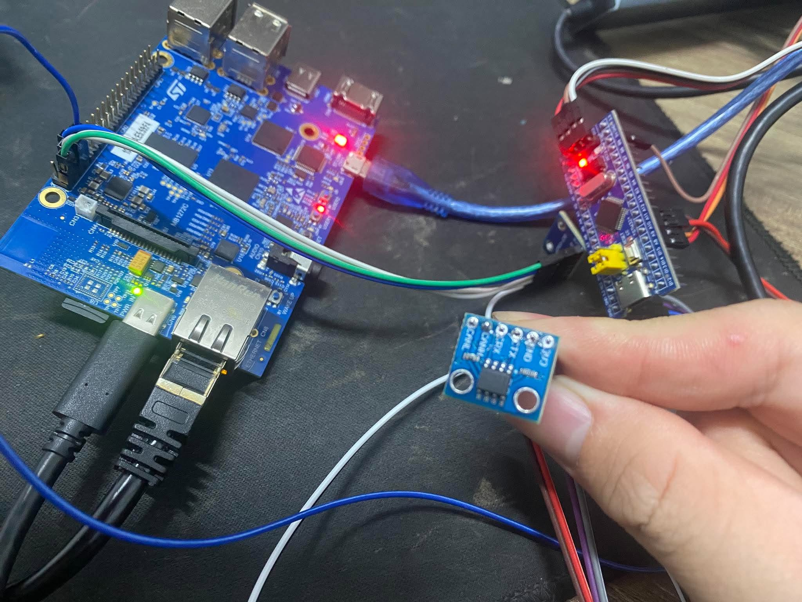
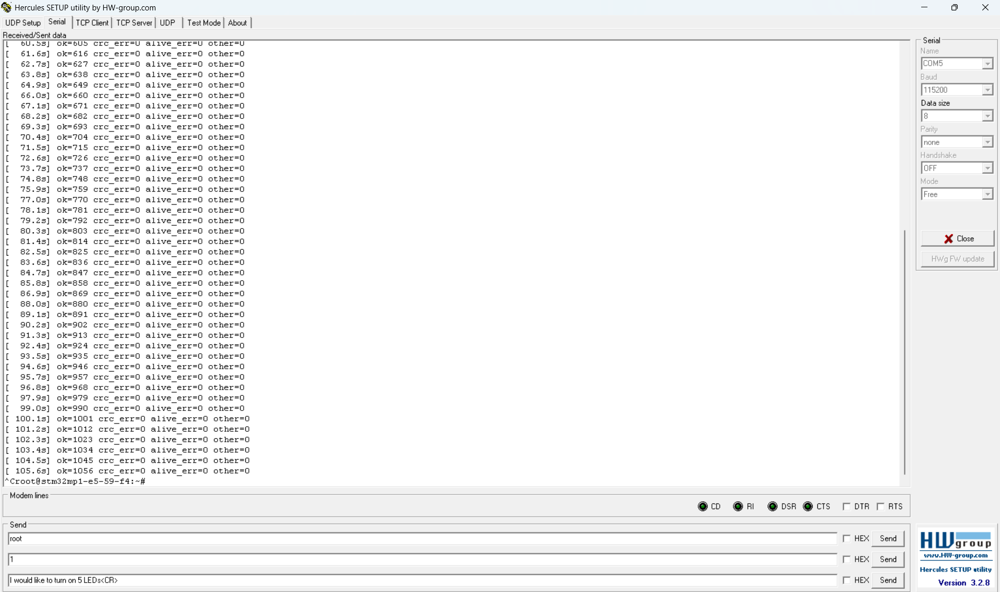
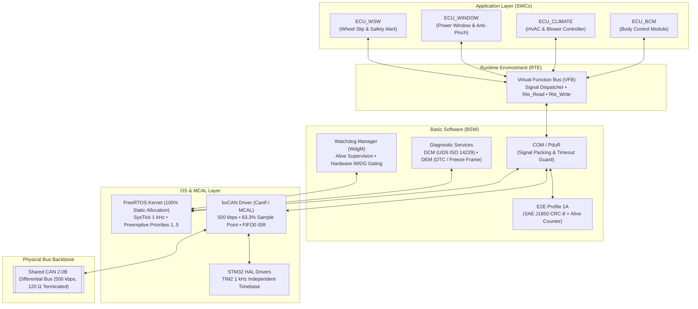
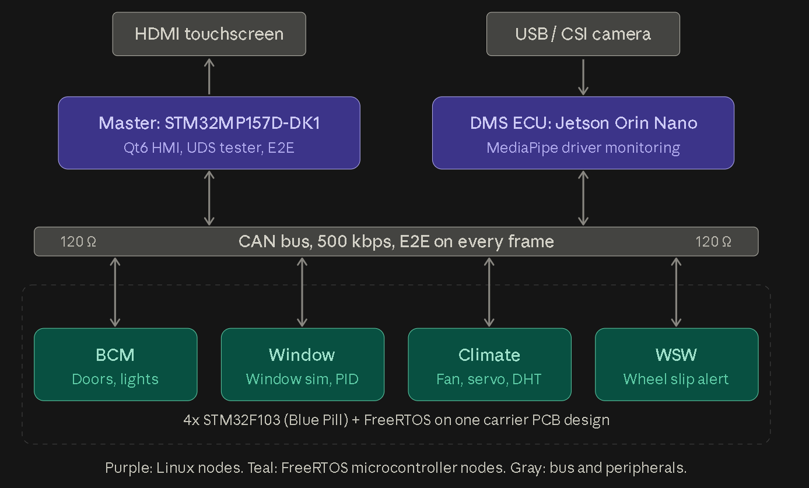
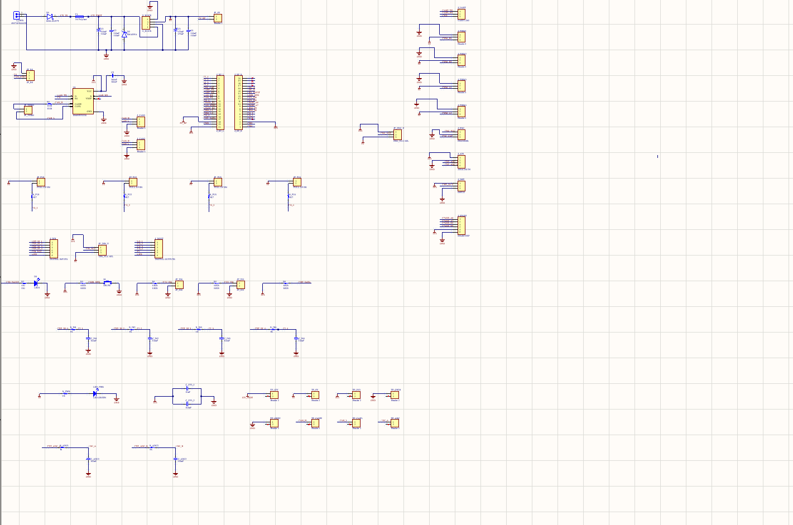
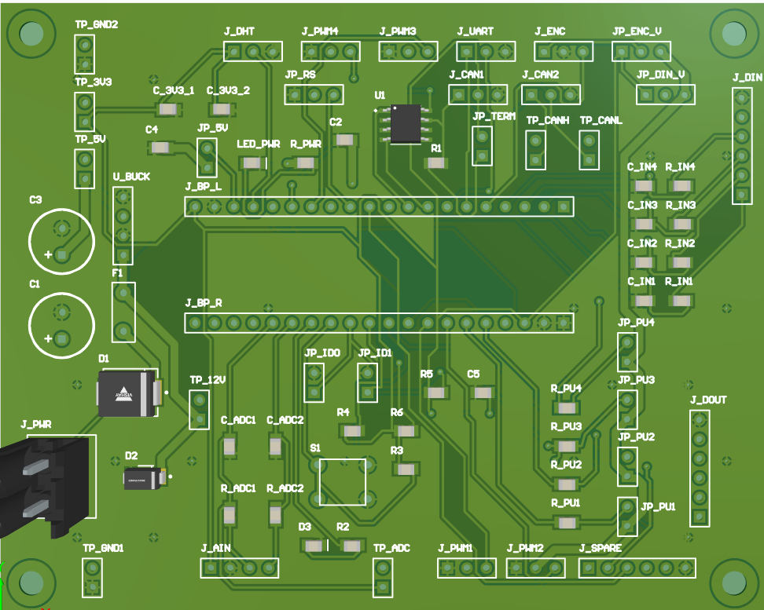

# Automotive Multi-ECU CAN Bus Network & Body Control System

[](https://en.wikipedia.org/wiki/C99)
[-brightgreen.svg)](https://www.freertos.org/)
[](https://www.autosar.org/)
[](https://www.st.com/en/microcontrollers-microprocessors/stm32f103.html)
[](https://en.wikipedia.org/wiki/CAN_bus)
[-red.svg)](doc/CAN-byte-layout.md)
[%20%2B%20DEM-purple.svg)](ecu-firmware/ecu-firmware/common/)
[](ecu-firmware/ecu-firmware/tests/)
[](Thesis/ECU_Carrier_Board/)

A distributed automotive electronic control system featuring 4 Electronic Control Units (ECUs) interconnected via a high-speed CAN 2.0B bus. Built upon an **AUTOSAR Classic-inspired 4-layer architecture** (`ASW` → `RTE` → `BSW` → `MCAL`) and executed on **deterministic, 100% statically allocated FreeRTOS** runtimes. Includes end-to-end (E2E) functional safety CRC protection, standardized UDS diagnostics (ISO 14229), a custom 4-node PCB carrier board, and a 100% passing host unit test suite.

---

## 🎬 Live Hardware Demonstration

[](https://drive.google.com/file/d/1pLO-NHE3jXmwbYgq4MFZFooruoL_e69R/view?usp=sharing)

### [▶️ Watch Hardware CAN 500 kbps + E2E Bring-Up Demo Video (Google Drive)](https://drive.google.com/file/d/1pLO-NHE3jXmwbYgq4MFZFooruoL_e69R/view?usp=sharing)

The demonstration verifies physical CAN bus bring-up between an STM32F103 microcontroller node running static FreeRTOS and a Linux SocketCAN master at **500 kbps (83.3% sample point)**:
- Real-time transmission and reception of CAN frames protected by **AUTOSAR E2E Profile 1A** (SAE J1850 CRC-8 + 4-bit Alive Counter).
- Continuous terminal logging showing zero frame drops (`ok` counter incrementing at 10 Hz, `crc_err=0`, `alive_err=0`).
- Runtime fault injection validation: intentional CRC bit-flipping on the bus is immediately detected, logged, and isolated without destabilizing the real-time scheduler.

| Real-Time Bench Bring-Up | UART Telemetry & E2E Validation |
| :---: | :---: |
|  |  |

---

## 🌟 Key Engineering Highlights

### 1. 4-Layer AUTOSAR Classic-Inspired Architecture
Structured strict separation of concerns following AUTOSAR Classic methodology:
- **Application Software (ASW)**: Independent Software Components (**SWCs**) for `ECU_BCM`, `ECU_CLIMATE`, `ECU_WINDOW`, `ECU_WSW`, and `bringup_bluepill`.
- **Runtime Environment (RTE)**: Decouples SWCs from underlying communication stacks via Virtual Function Bus (VFB) APIs (`Rte_Read`, `Rte_Write`, runnable dispatchers).
- **Basic Software (BSW)**: Standardized system and communication services:
  - **COM / PduR**: Signal packing/unpacking against DBC matrix with RX timeout monitoring.
  - **Diagnostic Stack**: ISO 14229 UDS services (DCM) and fault storage with Freeze Frame snapshots (DEM).
  - **Watchdog Manager (WdgM)**: Alive supervision gating hardware Independent Watchdog (IWDG).
  - **E2E Library**: AUTOSAR Profile 1A data integrity validation.
- **Microcontroller Abstraction Layer (MCAL)**: bxCAN hardware driver, pin remapping, and dedicated timer timebases.

### 2. Deterministic FreeRTOS Runtime Execution
- **Zero Dynamic Memory Allocation**: `configSUPPORT_STATIC_ALLOCATION = 1` and `configSUPPORT_DYNAMIC_ALLOCATION = 0`. All task control blocks, stacks, and queues are pre-allocated at compile time to eliminate runtime heap fragmentation and out-of-memory panics.
- **Strict Preemptive Priority Assignment**: 5 priority levels (`task_can_rx` at Priority 5 down to `task_blink` at Priority 1).
- **Jitter-Free Periodicity**: Periodic runnables scheduled via `vTaskDelayUntil()`.
- **Dual Independent Timebases**:
  - `SysTick` is dedicated exclusively to the FreeRTOS 1 kHz scheduler tick.
  - General-Purpose Timer `TIM2` provides an independent 1 kHz timebase for STM32 HAL, avoiding lockups during ISR-disabled sections.

### 3. Functional Safety & Diagnostic Protocols
- **AUTOSAR E2E Profile 1A**: Protects safety-critical CAN signals against communication faults (corruption, loss, repetition, masquerading) using a rolling 4-bit Alive Counter and an 8-bit SAE J1850 CRC polynomial ($x^8 + x^4 + x^3 + x^2 + 1$, `0x1D`).
- **UDS (ISO 14229) Diagnostics (DCM)**: Supports Diagnostic Session Control (`0x10`), ECU Reset (`0x11`), Clear Diagnostic Information (`0x14`), Read DTC Information (`0x19`), Read Data by Identifier (`0x22`), and Tester Present (`0x3E`).
- **Diagnostic Event Manager (DEM)**: Manages Diagnostic Trouble Codes (DTCs), qualification debouncing, status byte state machine, and freeze-frame telemetry capture.
- **Watchdog Manager (WdgM)**: Supervised entities report alive tokens cyclically; missing checkpoints trigger deliberate reset via STM32 hardware IWDG.

### 4. 100% Host-Based Verification (Unity Test Framework)
5 automated unit test suites compiled on the host machine via GCC/MinGW without requiring embedded hardware, providing full regression safety across signal packing, state machines, and runnables.

### 5. Custom 4-ECU Carrier Board PCB (Altium Designer)
A purpose-built dual-layer carrier board designed in Altium Designer housing all 4 STM32F103 modules, 4 onboard SN65HVD230 transceivers, localized power regulation, and external interface headers.

---

## 📐 System Architecture



---

## 🚗 Multi-ECU Node Allocation

| ECU Node | Primary Responsibilities | Sensors & Actuators | CAN Messages Produced |
|---|---|---|---|
| **ECU_BCM** | Exterior/interior lighting, door lock actuators, horn buzzer, driver hazard inputs | Pushbuttons, switches, LEDs, relay outputs, buzzer | `0x100` BCM_Status (100 ms)<br>`0x101` BCM_Command (50 ms) |
| **ECU_CLIMATE** | Automatic cabin temperature regulation, PWM fan control, airflow vane servo | DHT11/DHT22 temperature & humidity, potentiometer, PWM driver | `0x200` Climate_Status (100 ms) |
| **ECU_WINDOW** | Driver & passenger window motor control, anti-pinch safety threshold detection | H-Bridge driver (L9110S/L298N), current shunt sensor, limit switches | `0x300` Window_Status (50 ms) |
| **ECU_WSW** | Wheel speed pulse measurement, slip estimation, automatic hazard trigger | Hall-effect / optical wheel speed encoder, alarm buzzer | `0x400` WSW_Status (20 ms) |
| **DK1 Master** | Host gateway, telemetry logging, SocketCAN test supervisor, UDS diagnostics | Linux embedded host (Jetson / STM32MP1 / PC) | `0x6F1` Host_Command<br>`0x7DF` UDS Functional Request |



---

## 🖨️ Custom 4-ECU Carrier Board PCB

The project features a dedicated **4-ECU Carrier Board** designed in Altium Designer (`Thesis/ECU_Carrier_Board/`):
- **Centralized Power Regulation**: Converts 12 V automotive battery rail down to 5 V (step-down buck) and 3.3 V for MCU logic.
- **Integrated CAN Transceiver Array**: 4 onboard TI SN65HVD230 transceivers with localized bypass capacitors and optimized differential pair routing.
- **Controlled Impedance Termination**: Dual 120 Ω split termination scheme at the bus edges with optional jumper disconnects.
- **Modular Hardware Interfacing**: Direct socket mounting for 4 STM32 Blue Pill boards with dedicated breakout headers for motor drivers, encoders, relays, and sensor modules.

| Schematic Overview | PCB Top Layer (3D Render) | PCB Bottom Layer (3D Render) |
| :---: | :---: | :---: |
|  |  |  |

---

## 📁 Repository Structure

```
.
├── .gitignore                          # Build, Altium, Python, and IDE ignore rules
├── README.md                           # Master project documentation
├── result/                             # Hardware demonstration captures, schematics & PCB renders
│   ├── bring_upCAN.jpg                 # Bench hardware bring-up photo
│   ├── terminal_bringup.png            # UART console verification log
│   ├── overview_system.png             # System connectivity diagram
│   ├── Schematic.png                   # Carrier board schematic diagram
│   ├── PCB_TopSide.png                 # Altium PCB top 3D render
│   └── PCB_Bottom SIde.png             # Altium PCB bottom 3D render
├── doc/                                # System requirements, CAN DBC, and engineering notes
│   ├── can_matrix.dbc                  # Formal CAN network signal matrix
│   ├── CAN-byte-layout.md              # Frame packing & byte alignment specifications
│   ├── Kien-truc-Firmware-AUTOSAR.md   # Detailed AUTOSAR firmware architecture manual
│   ├── PCB-Requirements-4ECU.md        # Hardware carrier board electrical requirements
│   └── e2e_reference.py                # Reference Python implementation of E2E Profile 1A
├── Thesis/
│   └── ECU_Carrier_Board/              # Altium Designer PCB Project (.PrjPcb, .SchDoc, .PcbDoc)
└── ecu-firmware/ecu-firmware/          # Production firmware & host test suite
    ├── CMakeLists.txt                  # Top-level build configuration (cross-target)
    ├── CMakePresets.json               # CMake presets for debug, release, loopback
    ├── README.md                       # Firmware-specific technical guide
    ├── apps/                           # Application SWCs (BCM, Climate, Window, WSW, Bringup)
    ├── rte/                            # Virtual Function Bus & RTE generation headers
    ├── common/                         # BSW Services (CAN Driver, COM, E2E CRC, DCM, DEM, WdgM)
    ├── platform/                       # OS & HAL Integration (FreeRTOSConfig, TIM2, Interrupts)
    ├── linker/                         # Cortex-M3 flash linker script (STM32F103C8Tx)
    ├── scripts/                        # Dependency fetching scripts (fetch_deps.ps1, fetch_deps.sh)
    ├── tests/                          # Automated host unit tests using Unity framework
    └── tools/                          # SocketCAN testing & verification tools (dk1_can_test.py)
```

---

## ⚡ Quick Start: Build, Flash & Verify

### 1. Prerequisites
- **Cross-Compiler**: [Arm GNU Toolchain](https://developer.arm.com/downloads/-/arm-gnu-toolchain-downloads) (`arm-none-eabi-gcc` 13+)
- **Build System**: CMake ≥ 3.22 and Ninja
- **Host Compiler**: GCC (MinGW-w64 on Windows or native GCC on Linux) for host unit testing
- **Flashing / Debug**: OpenOCD and ST-Link v2

### 2. Fetch Third-Party Dependencies
Download FreeRTOS-Kernel, CMSIS Core/Device, STM32 HAL drivers, and Unity into `ecu-firmware/ecu-firmware/third_party/`:
```powershell
# Windows
cd ecu-firmware\ecu-firmware
.\scripts\fetch_deps.ps1
```
```bash
# Linux / macOS
cd ecu-firmware/ecu-firmware
./scripts/fetch_deps.sh
```

### 3. Run Automated Host Unit Tests (No Target Board Required)
Build and execute all 5 host unit test suites using the Unity test harness:
```bash
cd ecu-firmware/ecu-firmware
cmake -S tests -B build/tests
cmake --build build/tests
ctest --test-dir build/tests --output-on-failure
```
**Expected Test Output:**
```
Test project C:/Study/Thesis_BEng/ecu-firmware/ecu-firmware/build/tests
    Start 1: crc8
1/5 Test #1: crc8 .............................   Passed    0.02 sec
    Start 2: e2e_state_machine
2/5 Test #2: e2e_state_machine ................   Passed    0.03 sec
    Start 3: com_packing
3/5 Test #3: com_packing ......................   Passed    0.02 sec
    Start 4: diag_wdgm
4/5 Test #4: diag_wdgm ........................   Passed    0.03 sec
    Start 5: swc_runnables
5/5 Test #5: swc_runnables ....................   Passed    0.02 sec

100% tests passed out of 5
```

### 4. Cross-Compile ECU Firmware Binaries
```bash
cd ecu-firmware/ecu-firmware
cmake --preset debug
cmake --build --preset debug
```
Binaries generated in `build/debug/`:
- `bringup_bluepill.elf` / `.bin` / `.hex`
- `ecu_bcm.elf` / `.bin` / `.hex`
- `ecu_climate.elf` / `.bin` / `.hex`
- `ecu_window.elf` / `.bin` / `.hex`
- `ecu_wsw.elf` / `.bin` / `.hex`

### 5. Flash Target Node via OpenOCD
Connect an ST-Link v2 to the SWD header (`SWDIO`, `SWCLK`, `GND`) of the target STM32 node:
```bash
openocd -f interface/stlink.cfg -f target/stm32f1x.cfg -c "program build/debug/ecu_bcm.elf verify reset exit"
```

### 6. Verify Over CAN Bus with Linux SocketCAN
On the master node (Raspberry Pi, Jetson, or Linux PC with CAN adapter):
```bash
# Configure CAN interface
sudo ip link set can0 down
sudo ip link set can0 type can bitrate 500000 sample-point 0.833
sudo ip link set can0 up

# Listen to incoming E2E frames
python3 tools/dk1_can_test.py rx can0

# Inject periodic commands and verify CRC checking
python3 tools/dk1_can_test.py tx can0 --period-ms 100 --corrupt 20
```

---

## 📜 Standards & References

- **AUTOSAR Classic Platform Release 4.4.0**:
  - `AUTOSAR_SWS_E2ELibrary` (Profile 1A, SAE J1850 CRC-8)
  - `AUTOSAR_SWS_COM` (Signal packing & endianness conversion)
  - `AUTOSAR_SWS_DiagnosticCommunicationManager` (ISO 14229-1 UDS)
  - `AUTOSAR_SWS_DiagnosticEventManager` (DTC state storage)
  - `AUTOSAR_SWS_WatchdogManager` (Alive supervision)
- **ISO 11898-1 / ISO 11898-2**: Road vehicles — Controller area network (CAN)
- **ISO 14229-1**: Road vehicles — Unified diagnostic services (UDS)
- **FreeRTOS Kernel V11.2.0**: Static memory allocation and real-time scheduling

---

## 👤 Author & Acknowledgments

- **Author**: Do Buu Phuoc
- **Institution**: Ho Chi Minh International University - VNU (HCMIU)
- **Supervision**: MEng Vo Minh Thanh

---

## 📄 License

This project is licensed under the **MIT License** — see the [LICENSE](LICENSE) file for details.
