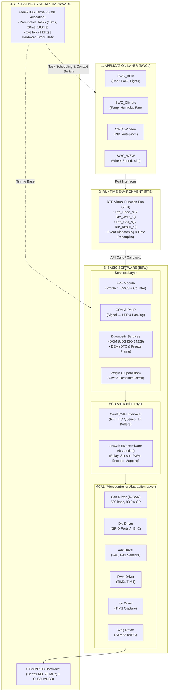

# ECU Firmware Platform Architecture Based on the AUTOSAR Classic Layered Model

> **Thesis Topic:** Design and Evaluation of a Miniature Automotive E/E Platform over CAN with End-to-End Protection and Fault Management  
> *(Thiết kế và đánh giá nền tảng E/E ô tô thu nhỏ dựa trên CAN với bảo vệ E2E và quản lý lỗi)*  
> **Target System:** 4 STM32F103 microcontroller ECUs (BCM, Window, Climate, WSW) connected via a 500 kbps CAN bus  
> **Reference Standards:** AUTOSAR Classic Platform Release 4.4 / R20-11, ISO 14229-1 (UDS), ISO 26262 (Functional Safety / E2E Protection)

---

## 1. Context and Architectural Strategy

### 1.1. Technical Challenges and Architectural Decisions
In the automotive industry, the **AUTOSAR Classic (Automotive Open System Architecture)** software standard establishes the industry baseline for decoupling application software from underlying hardware, maximizing software component reusability, and enforcing functional safety. However, adopting it on resource-constrained academic hardware poses distinct challenges:
- Commercial full-stack AUTOSAR Classic implementations (such as Vector DaVinci, Elektrobit tresos, or ETAS ISOLAR) require costly enterprise licenses ($10,000s USD) and substantial memory footprints (typically Flash > 256 KB, RAM > 32 KB).
- The four microcontrollers in this project utilize the **STM32F103C8T6 (ARM Cortex-M3, 64/128 KB Flash, 20 KB RAM)**. STMicroelectronics does not supply an official AUTOSAR Microcontroller Abstraction Layer (MCAL) for this MCU series, and available memory is too restricted for full commercial stacks.

**Solution: Spec-Compliant Custom BSW Layered Architecture**  
To achieve automotive-grade architectural rigor within these constraints, this project implements an **AUTOSAR-inspired Layered Architecture**. The firmware is decomposed into four standard AUTOSAR layers: **Application Layer (SWC) → Runtime Environment (RTE) → Basic Software (BSW: Services, ECU Abstraction, MCAL) → Microcontroller Hardware**, strictly implementing key automotive specifications:
1. **AUTOSAR E2E Transformer / Profile 1:** End-to-End communication integrity protection (4-bit Alive Counter, DataID, CRC-8/SAE-J1850, and 3-strike debounce state machine).
2. **AUTOSAR COM & PduR Abstraction:** Signal packing and unpacking against the DBC network matrix (`can_matrix.dbc`).
3. **AUTOSAR DCM & DEM:** Unified Diagnostic Services (UDS, ISO 14229) processing, Diagnostic Trouble Code (DTC) management, and Freeze Frame / Snapshot data capture.
4. **AUTOSAR OS Abstraction:** Mapped onto the **FreeRTOS** real-time kernel utilizing preemptive multitasking and 100% static memory allocation.

---

## 2. Layered Architecture Diagram



---

## 3. Detailed Architectural Layers

### 3.1. Application Layer (SWC)
Each ECU executes one or more modular **Software Components (SWCs)** containing pure application and control logic, with zero direct dependencies on hardware drivers or registers (no direct STM32 HAL or CMSIS register calls).

- **Port-Based Communication:**
  - **Sender-Receiver (S/R) Ports:** Used for cyclical data transfer (e.g., `WheelSpeed_Port`, `DoorStatus_Port`, `Temperature_Port`).
  - **Client-Server (C/S) Ports:** Used for synchronous or asynchronous service requests (e.g., `SetLockState_Port`, `LogDTC_Port`).
- **Runnable Entities:** Execution functions invoked by RTE events:
  - *Periodic Runnables:* Triggered at fixed timing intervals (e.g., `WSW_MainFunction_20ms()`, `BCM_MainFunction_100ms()`).
  - *Event-Driven Runnables:* Triggered upon incoming CAN frames or hardware interrupts (e.g., `On_CAN_Frame_Received()`, `On_Pinch_Detected()`).

| SWC | Target Node | Key Runnable Entities | Input Ports | Output Ports |
| :--- | :--- | :--- | :--- | :--- |
| **SWC_BCM** | BCM ECU | `BCM_100ms_Runnable()`<br/>`BCM_CmdHandler_Runnable()` | `Rte_Port_DoorSensor`<br/>`Rte_Port_LightSensor`<br/>`Rte_Port_WheelSpeed`<br/>`Rte_Port_DMSAlert` | `Rte_Port_LockActuator`<br/>`Rte_Port_HeadlightPWM`<br/>`Rte_Port_CabinPWM`<br/>`Rte_Port_Buzzer` |
| **SWC_Climate** | Climate ECU | `Climate_100ms_Runnable()`<br/>`Climate_SensorRead_2s()` | `Rte_Port_DHT_Sensors`<br/>`Rte_Port_ClimateCmd`<br/>`Rte_Port_DMSAlert` | `Rte_Port_FanPWM`<br/>`Rte_Port_ServoVane`<br/>`Rte_Port_FogWarning` |
| **SWC_Window** | Window ECU | `Window_10ms_PID_Runnable()`<br/>`Window_Cmd_Runnable()` | `Rte_Port_WindowCmd`<br/>`Rte_Port_ObstacleSensor` | `Rte_Port_VirtualMotorPosition`<br/>`Rte_Port_PinchStatus` |
| **SWC_WSW** | WSW ECU | `WSW_20ms_Capture_Runnable()`<br/>`WSW_SlipCalc_Runnable()` | `Rte_Port_EncoderCapture`<br/>`Rte_Port_BrakeSwitch` | `Rte_Port_WheelSpeedRPM`<br/>`Rte_Port_SlipWarning`<br/>`Rte_Port_FreezeFrameTrigger` |

---

### 3.2. Runtime Environment (RTE)
The **RTE** acts as the Virtual Function Bus (VFB) interconnecting SWCs with each other and binding SWCs to underlying BSW services.
- **Application Isolation:** Application code references only generated `Rte_<SWC>.h` headers. Migrating code from STM32F103 to another MCU family or reallocating an SWC to another ECU requires **zero modifications to the SWC business logic**.
- **API Convention:**
  ```c
  /* Example in SWC_BCM: Reads signals via RTE rather than accessing HAL directly */
  Std_ReturnType Rte_Read_Port_WheelSpeed(uint16_t* speed_rpm);
  Std_ReturnType Rte_Write_Port_DoorStatus(uint8_t door_open);
  Std_ReturnType Rte_Call_Port_SetLockRelay(LockState_t state);
  ```
- **Event Dispatcher:** Maps real-time FreeRTOS OS tasks to runnable entities in SWCs:
  ```c
  void Task_WSW_20ms(void *pvParameters) {
      TickType_t xLastWakeTime = xTaskGetTickCount();
      for(;;) {
          Rte_WSW_SlipCalc_Runnable();
          vTaskDelayUntil(&xLastWakeTime, pdMS_TO_TICKS(20));
      }
  }
  ```

---

### 3.3. Basic Software (BSW) — Services Layer

#### A. E2E Transformer Module (AUTOSAR E2E Profile 1)
Guarantees inter-ECU communication data integrity against bit errors, message loss, repetition, and masquerading in compliance with **ISO 26262 ASIL B/D** principles:
- **Protection Field Structure in Every CAN Frame:**
  - **Dynamic DLC Allocation:** Each message utilizes a fixed DLC specified in `can_matrix.dbc` (ranging from 3 to 8 bytes, e.g., `WINDOW_CMD` DLC=3, `WSW_WARNING` DLC=4, `CLIMATE_CMD` DLC=5, `WHEEL_SPEED` DLC=7, `CLIMATE_STATUS` DLC=8; bring-up test frames `0x6F0/0x6F1` use DLC=8).
  - **Alive_Counter (4-bit):** Increments from 0 to 15 on each transmission ($0 \rightarrow 15 \rightarrow 0$ rollover with validation limit $MAX\_DELTA = 3$). Detects dropped, repeated, delayed, or frozen frames.
  - **CRC-8/SAE-J1850:** **Always placed in the last byte of the payload (`byte[DLC - 1]`)**, computed over an array consisting of `DataID` followed by all preceding payload bytes: `[DataID, byte[0], byte[1], ..., byte[DLC - 2]]`.
    - Polynomial: $P(x) = x^8 + x^4 + x^3 + x^2 + 1$ (`0x1D`), Init: `0xFF`, no bit reflection, XorOut: `0xFF`. Standard test vector: `crc8("123456789") = 0x4B`.
    - `DataID`: Unique 1-byte constant per CAN message ID (configured via DBC attribute `E2E_DataID`, e.g., `0x3C` for `WSW_WARNING`, `0x5A` for `WHEEL_SPEED`, `0xA0/0xB1` for bring-up frames), preventing masquerading faults.
- **E2E Receiver State Machine:**
  - Verification states: `E2E_P01STATUS_OK`, `E2E_P01STATUS_NONEWDATA`, `E2E_P01STATUS_WRONGCRC`, `E2E_P01STATUS_INITIAL`, `E2E_P01STATUS_REPEATED`, `E2E_P01STATUS_OKSOMELOST`, `E2E_P01STATUS_WRONGSEQUENCE`.
  - **Debounce Filter (3-Strike Rule):** Requires 3 consecutive invalid frames before latching the signal as `INVALID` and engaging failsafe degradation; requires 3 consecutive valid frames for automatic recovery.

#### B. COM & PduR (PDU Router)
- **Signal Packing & Unpacking:** Serializes and deserializes structured C variables to and from Protocol Data Units (I-PDUs) according to `can_matrix.dbc`.
- **Transmission Modes:**
  - Periodic (20 ms for WSW, 100 ms for BCM, Climate, and DMS).
  - Event-triggered (state transitions on brake activation or wheel slip warning).
- **Deadline Monitoring (Timeout):** Flags an error if an expected periodic PDU is missing for more than $3 \times$ its nominal period.

#### C. Diagnostic Services: DCM & DEM
- **DCM (Diagnostic Communication Manager):** Implements **UDS (ISO 14229)** server functionality over CAN:
  - `0x10 DiagnosticSessionControl`: Default Session and Extended Diagnostic Session handling.
  - `0x22 ReadDataByIdentifier`: Queries real-time telemetry (DIDs: wheel speed, cabin temperature, bus voltage, vane angle).
  - `0x19 ReadDTCInformation`: Retrieves DTC status mask and snapshot records (sub-function `0x02`).
  - `0x14 ClearDiagnosticInformation`: Resets stored diagnostic trouble codes.
- **DEM (Diagnostic Event Manager):**
  - Standard 3-byte DTC representation (e.g., `0xD00001` - Bus-Off, `0xD00002` - E2E CRC Error, `0xD00003` - Signal Reception Timeout).
  - **Freeze Frame / Snapshot Data:** Latches critical system telemetry (current, voltage, wheel speed, timestamp) at the exact moment a fault triggers. Given the absence of external EEPROM, snapshot data is preserved in protected static RAM.

#### D. WdgM (Watchdog Manager & Alive Supervision)
- Rather than a simplistic periodic watchdog kick that cannot detect deadlocked background threads, **WdgM** implements multi-entity **Alive Supervision**:
  - Each real-time task (20 ms, 100 ms, background) maintains an independent checkpoint counter.
  - A supervisory entity (`WdgM_MainFunction`) verifies that all registered tasks execute within expected cycle windows.
  - Only when **all monitored tasks report healthy execution** does WdgM refresh the hardware Independent Watchdog (IWDG). If any task deadlocks, the IWDG times out and resets the MCU safely.

---

### 3.4. ECU Abstraction & MCAL Layer

#### A. CanIf (CAN Interface) & Can Driver (MCAL)
- **Can Driver:** Directly configures the STM32F103 on-chip **bxCAN** peripheral:
  - APB1 bus clock = 36 MHz.
  - Prescaler = 4, BS1 = 14 tq, BS2 = 3 tq, SJW = 1 tq → **500 kbps**, **83.3% Sample Point**.
  - Hardware filter banks configured to accept only DBC-defined message IDs, offloading CPU interrupt processing.
- **CanIf:** Provides an abstraction barrier between bxCAN hardware and higher BSW layers:
  - Statically allocated RX FIFO ring buffers safely serviced by CAN RX FIFO0 interrupts.
  - Re-entrant, non-blocking transmission queues (Non-blocking TX).

#### B. IoHwAb & Peripheral Drivers
- **Dio Driver:** Controls digital outputs for door lock relays, active buzzer, and warning indicators.
- **Pwm Driver:** Configures hardware timers TIM3 and TIM4 for high-frequency LED dimming, motor speed control, and 50 Hz vane servo positioning.
- **Adc Driver:** Performs analog-to-digital conversions on PA0 and PA1 for LDR light sensing and simulated analog potentiometers.
- **Icu Driver (Input Capture):** Configures TIM1_CH1 (PA8) for edge-to-edge period capture on the WSW wheel speed encoder, achieving high-accuracy rotational measurement without window latency.

---

### 3.5. Operating System & Timing Management (OS Layer)
- **FreeRTOS Kernel (v11.2.0):**
  - **100% Static Allocation (`configSUPPORT_DYNAMIC_ALLOCATION 0`):** Strict prohibition of runtime `malloc()` and `pvPortMalloc()`. Complies with MISRA-C and automotive coding standards, entirely eliminating heap fragmentation risks.
  - **Dual Independent Interrupt Hierarchy:**
    - `SysTick`: Dedicated exclusively to the FreeRTOS scheduler tick (1000 Hz, 1 ms resolution).
    - `TIM2`: Hardware 1 kHz timer dedicated to the STM32 HAL timebase, eliminating interrupt resource contention.
  - **Stack Protection:** Enabled `configCHECK_FOR_STACK_OVERFLOW 2`, actively verifying stack limit watermarks for every task.

---

## 4. Source Tree Architectural Mapping

The firmware codebase under `ecu-firmware/` maps directly onto standard AUTOSAR architectural layers:

```
ecu-firmware/
├── apps/                               # [APPLICATION LAYER - SWC]
│   ├── bringup_bluepill/               # Bring-up verification SWC
│   ├── ecu_bcm/                        # Body Control Module SWC (Door, Lock, Lighting)
│   ├── ecu_climate/                    # Climate Control SWC (Fan, Temp, Air Vane)
│   ├── ecu_window/                     # Power Window SWC (PID, Anti-pinch)
│   └── ecu_wsw/                        # Wheel Slip Warning SWC (Speed, Slip Detection)
│
├── rte/                                # [RUNTIME ENVIRONMENT - RTE]
│   ├── Rte_BCM.h                       # Virtual Function Bus API for BCM
│   ├── Rte_Climate.h                   # Virtual Function Bus API for Climate
│   ├── Rte_Window.h                    # Virtual Function Bus API for Window
│   ├── Rte_WSW.h                       # Virtual Function Bus API for WSW
│   └── Rte_Type.h                      # Standardized data types for inter-SWC exchange
│
├── common/                             # [BSW: SERVICES & HARDWARE ABSTRACTION]
│   ├── board_pins.h                    # IoHwAb: Pin mappings for 4-ECU carrier board
│   ├── can_driver.c / .h               # CanIf + bxCAN MCAL Driver (500 kbps, ring buffer FIFO0)
│   ├── e2e_crc8.c / .h                 # AUTOSAR E2E Profile 1 (CRC8 + 4-bit Counter)
│   ├── log.c / .h                      # Debug serial logging via UART
│   ├── can_com.c / .h                  # COM & PduR (Signal packing, DBC unpacking)
│   ├── diag_dcm.c / .h                 # DCM (UDS Server ISO 14229: 0x10, 0x22, 0x19)
│   ├── diag_dem.c / .h                 # DEM (DTC Management, Event Debounce, Freeze Frame)
│   └── wdgm.c / .h                     # Watchdog Manager & Multi-Task Alive Supervision
│
├── platform/                           # [BSW: OS & PLATFORM HAL]
│   ├── FreeRTOSConfig.h                # Static OS configuration, stack overflow detection
│   ├── freertos_hooks.c                # Stack overflow hook and idle task hooks
│   ├── hal_timebase_tim2.c             # Dedicated 1 kHz TIM2 hardware timebase for STM32 HAL
│   ├── stm32f1xx_hal_conf.h            # STM32 HAL peripheral configuration
│   ├── stm32f1xx_it.c                  # Interrupt vector service routines (CAN RX, SysTick, TIM2)
│   └── syscalls.c                      # GCC newlib runtime syscall stubs
│
└── tests/                              # [VERIFICATION & UNIT TEST]
    ├── test_crc8.c                     # Unity unit test for CRC-8/SAE-J1850 algorithm
    ├── test_e2e_state_machine.c        # Unity test for E2E receiver debounce state machine
    └── test_com_packing.c              # Unit tests for DBC signal serialization/deserialization
```

---

## 5. Mapping of AUTOSAR Concepts to Project Implementation

| AUTOSAR Classic Concept | Implementation in Project | Concrete Architectural Role |
| :--- | :--- | :--- |
| **SWC (Software Component)** | Modules in `apps/ecu_*` | Encapsulates domain logic: button reading, light sequencing, slip calculation, anti-pinch motor control. |
| **Runnable Entity** | Cyclic and event-driven functions | `WSW_MainFunction_20ms()`, `BCM_MainFunction_100ms()`. |
| **VFB / RTE** | Headers `Rte_*.h` & Dispatcher | Decouples SWCs from BSW; SWCs interact exclusively via `Rte_Read`, `Rte_Write`, and `Rte_Call`. |
| **COM** | `common/can_com.c` | Serializes C runtime variables into CAN bit-fields based on DBC matrix layout. |
| **PduR (PDU Router)** | Routing logic in `can_driver` / `can_com` | Routes telemetry I-PDUs to COM and diagnostic I-PDUs to DCM. |
| **E2E Transformer (Profile 1)** | `common/e2e_crc8.c` | 4-bit Alive Counter, DataID, CRC-8/SAE-J1850 polynomial 0x1D. |
| **DCM (Diag Comm Manager)** | `common/diag_dcm.c` | Processes UDS 0x10, 0x22, and 0x19 requests from Linux Master (STM32MP157). |
| **DEM (Diag Event Manager)** | `common/diag_dem.c` | Records DTCs, manages 3-strike debounce counters, stores Freeze Frames in RAM. |
| **WdgM (Watchdog Manager)** | `common/wdgm.c` | Enforces multi-task Alive Supervision before refreshing hardware IWDG. |
| **CanIf (CAN Interface)** | `common/can_driver.c` | Buffers CAN RX/TX queues, provides hardware abstraction API for BSW. |
| **IoHwAb (ECU Abstraction)** | `common/board_pins.h` | Maps carrier board physical pinouts to MCU peripherals. |
| **MCAL Can** | Driver in `common/can_driver.c` + STM32 HAL/LL | Configures bxCAN bit timing for 500 kbps (83.3% sample point) and hardware acceptance filters. |
| **AUTOSAR OS** | FreeRTOS v11.2.0 (Static Allocation) | Real-time preemptive scheduling, level-2 stack checking, static memory. |

---

## 6. Thesis Defense and Oral Examination Strategy

During thesis defense presentations and committee review, candidates should emphasize the following scientific arguments:

1. **Demonstrating Automotive Architectural Rigor:**
   > *"Rather than adopting a monolithic embedded codebase typical of student projects, the firmware across all four ECUs strictly adheres to the **AUTOSAR Classic Layered Architecture**. Application business logic (SWCs) is completely insulated from target hardware through a standardized virtual RTE interface."*

2. **Technical Justification for Spec-Compliant Custom BSW:**
   > *"Given the project goal of optimizing bill-of-materials cost using standard STM32F103 microcontrollers (64 KB Flash, 20 KB RAM), deploying commercial proprietary stacks (e.g., Vector DaVinci or EB tresos) was infeasible due to memory limits and the lack of official ST MCAL packages. Consequently, our work developed a **Spec-Compliant Custom BSW**: implementing core BSW services (E2E Profile 1, UDS DCM/DEM, COM PDU Router, and Alive Supervision) strictly following AUTOSAR specifications and ISO 26262 / ISO 14229 standards."*

3. **Emphasis on Functional Safety Engineering:**
   > *"Inter-ECU data protection transcends simple checksums: our implementation enforces **AUTOSAR E2E Profile 1** with a complete 3-strike debounce recovery state machine, coupled with multi-task **Alive Supervision** for the hardware watchdog and standardized **Snapshot / Freeze Frame** error logging under UDS."*
