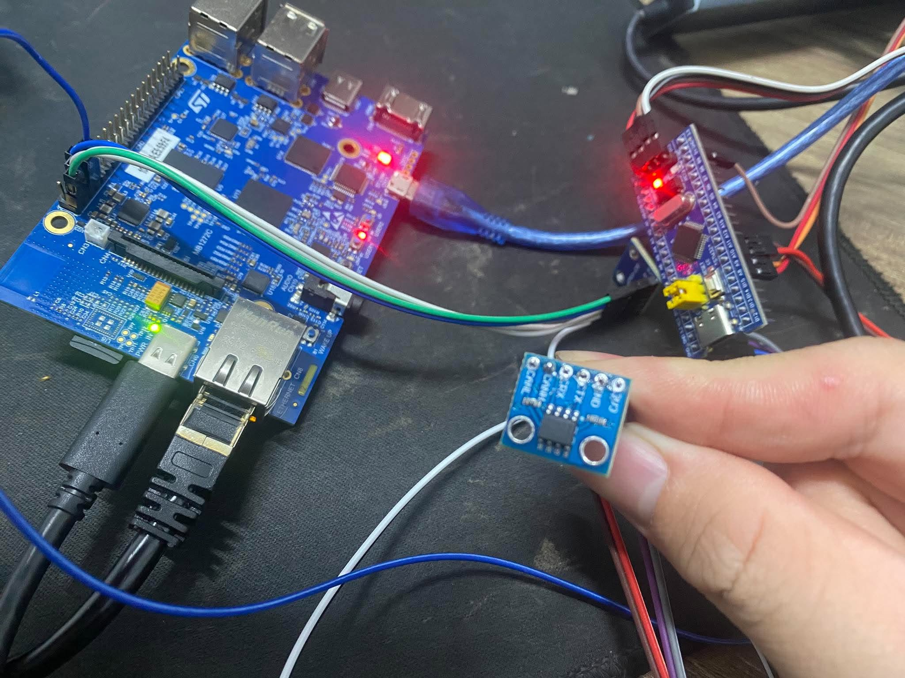

# ECU Firmware – Automotive Multi-Node Network (FreeRTOS Static + STM32 HAL + CMake)

Firmware implementation for 4 automotive Electronic Control Units (**BCM**, **Climate**, **Power Window**, **WSW**) plus a bring-up node running on STM32F103 (ARM Cortex-M3) microcontrollers. Built upon a 4-layer **AUTOSAR Classic-inspired architecture** with **100% static FreeRTOS runtime**, **CAN 2.0B at 500 kbps**, **AUTOSAR E2E Profile 1A data protection**, and **UDS (ISO 14229) diagnostics**.

[](https://drive.google.com/file/d/1pLO-NHE3jXmwbYgq4MFZFooruoL_e69R/view?usp=sharing)

> **[▶️ Watch Hardware CAN 500 kbps + E2E Bring-Up Demo (Google Drive)](https://drive.google.com/file/d/1pLO-NHE3jXmwbYgq4MFZFooruoL_e69R/view?usp=sharing)**  
> *Demonstrating bidirectional 500 kbps CAN communication between STM32F103 (FreeRTOS) and an embedded Linux host, real-time SAE J1850 CRC-8 calculation, 4-bit Alive Counter state machines, and hardware error injection handling.*

---

## 1. Toolchain & Dependencies

| Tool | Recommended Version | Purpose |
|---|---|---|
| **Arm GNU Toolchain** | `arm-none-eabi-gcc` 13.x+ | Cross-compiler for Cortex-M3 target binaries |
| **CMake & Ninja** | CMake ≥ 3.22, Ninja ≥ 1.10 | Cross-platform build automation & generator |
| **Host C Compiler** | GCC (MinGW-w64 / MSYS2 / Linux) | Builds and executes the 5 Unity host unit test suites |
| **OpenOCD (xPack)** | 0.12.0+ | SWD flashing and on-chip debugging via ST-Link v2 |
| **Python** | 3.8+ | SocketCAN test scripts and verification tools |

### Fetching Pinned Third-Party Dependencies
Download FreeRTOS-Kernel (v11.2.0), CMSIS Core (v5.9.0), CMSIS Device F1 (v4.3.4), STM32F1xx HAL (v1.1.10), and Unity (v2.6.0):
```bash
# Windows PowerShell
scripts\fetch_deps.ps1

# Linux / macOS / Git-Bash
scripts/fetch_deps.sh
```

---

## 2. Building & Testing

### Cross-Compiling Target Firmware
All 5 ECU executables (`bringup_bluepill`, `ecu_bcm`, `ecu_climate`, `ecu_window`, `ecu_wsw`) are configured via CMake Presets:
```bash
# Configure and build Debug firmware
cmake --preset debug
cmake --build --preset debug

# Or build Release firmware (optimized -Os)
cmake --preset release
cmake --build --preset release

# Or build CAN loopback diagnostic firmware (no external bus required)
cmake --preset debug-loopback
cmake --build --preset debug-loopback
```
Output artifacts are generated in `build/debug/` (or `build/release/`): `.elf`, `.bin`, `.hex`, and `.map` memory footprints (~19 KB Flash, ~8 KB RAM per node).

### Host-Based Unit Testing (Unity Test Suite)
Execute all 5 host unit test suites without physical hardware:
```bash
cmake -S tests -B build/tests
cmake --build build/tests
ctest --test-dir build/tests --output-on-failure
```
**Verification Coverage (5/5 Passing):**
1. `crc8`: Verifies bitwise SAE J1850 polynomial (`0x1D`), init (`0xFF`), xorout (`0xFF`) calculations.
2. `e2e_state_machine`: Tests sequence jumps, frame losses, repeated counters, and CRC error transitions.
3. `com_packing`: Validates big-endian signal serialization and DBC-compliant bit-packing.
4. `diag_wdgm`: Tests UDS DCM 0x10/0x11/0x14/0x19/0x22/0x3E, DEM DTC freeze frames, and WdgM alive supervision.
5. `swc_runnables`: Tests end-to-end RTE Virtual Function Bus interaction across all 4 SWC modules.

---

## 3. Flashing & Hardware Debugging
- **ST-Link Wiring**: Connect `SWDIO`, `SWCLK`, and `GND` (supply 3.3V only if not externally powered).
- **Flashing**: Execute OpenOCD task in VS Code or run:
  ```bash
  openocd -f interface/stlink.cfg -f target/stm32f1x.cfg -c "program build/debug/bringup_bluepill.elf verify reset exit"
  ```
  *(For clone chips with unexpected TAP ID `0x2ba01477`, append `-c "set CPUTAPID 0x2ba01477"` before `-f target/stm32f1x.cfg`).*
- **UART Telemetry**: Connect USB-UART adapter to **PA9 (MCU TX) → RX** and **PA10 (MCU RX) ← TX** at **115200 baud, 8N1**.

---

## 4. Layered AUTOSAR Classic Architecture

```
apps/                    [Application Layer - Software Components (SWCs)]
  bringup_bluepill/      Bring-up & CAN transceiver diagnostic node
  ecu_bcm/               SWC Body Control Module (Door Locks, Lighting, Buzzer, Hazards)
  ecu_climate/           SWC Climate Controller (Temperature, Humidity, Fan PWM, Air Vane)
  ecu_window/            SWC Power Window (H-Bridge Motor PWM, Anti-Pinch Obstacle Protection)
  ecu_wsw/               SWC Wheel Slip Warning (Wheel Speed Encoder, Slip Estimation, Alarms)
rte/                     [Runtime Environment - RTE]
  rte.c / Rte_*.h        Virtual Function Bus (VFB) APIs (Rte_Read, Rte_Write, Dispatcher)
common/                  [Basic Software (BSW) - Services & Hardware Abstraction]
  board_pins.h           IoHwAb: Hardware pin definitions for 4-ECU Carrier Board
  can_driver.c/.h        CanIf & CanDriver MCAL (bxCAN 500 kbps, 83.3% SP, ring-buffer FIFO0)
  e2e_crc8.c/.h          AUTOSAR E2E Profile 1A (4-bit Alive Counter + SAE J1850 CRC-8)
  can_com.c/.h           COM & PduR: Signal serialization, packing, and RX timeout monitoring
  diag_dcm.c/.h          DCM (UDS ISO 14229: Sessions 0x10, Reset 0x11, Read DID 0x22, TesterPresent 0x3E)
  diag_dem.c/.h          DEM (Diagnostic Event Manager: DTC status bitmask & Freeze Frame snapshots)
  wdgm.c/.h              WdgM: Watchdog Manager & Alive Supervision gating hardware IWDG
  log.c/.h               UART telemetry logger
platform/                [BSW - Operating System & Platform HAL]
  FreeRTOSConfig.h       Deterministic OS configuration: 100% static allocation, zero heap
  freertos_hooks.c       Stack Overflow Hook (Level 2) & Idle Hook
  hal_timebase_tim2.c    Dedicated 1 kHz hardware timebase for HAL (prevents SysTick contention)
  stm32f1xx_hal_conf.h   STM32 HAL peripheral selection
  stm32f1xx_it.c         Vector interrupt table (CAN RX FIFO0, SysTick, TIM2)
  syscalls.c             Newlib system call re-entrancy stubs
linker/                  Linker script for STM32F103C8 (64 KB Flash, 20 KB RAM)
tests/                   Host unit test suite with Unity framework (5 test modules)
tools/dk1_can_test.py    Linux SocketCAN master verification & error injection utility
```

---

## 5. Key Engineering Conventions & Real-Time Guarantees

1. **Dual Timebase Separation**:
   - `SysTick` is exclusively dedicated to the FreeRTOS 1 kHz kernel scheduler tick.
   - General-purpose timer `TIM2` provides a dedicated 1 kHz timebase for STM32 HAL (`platform/hal_timebase_tim2.c`), eliminating priority inversion and interrupt lockups during blocking HAL operations.
2. **Deterministic Memory Management**:
   - `configSUPPORT_STATIC_ALLOCATION = 1` and `configSUPPORT_DYNAMIC_ALLOCATION = 0`.
   - Dynamic memory heap (`malloc`/`free`) is disabled across all firmware, guaranteeing zero runtime memory fragmentation.
   - Stack Overflow Hook is enabled at Level 2 checking for watermark integrity.
3. **Interrupt Priority Discipline**:
   - FreeRTOS syscall limit: `configLIBRARY_MAX_SYSCALL_INTERRUPT_PRIORITY = 5`.
   - CAN RX FIFO0 interrupt priority is assigned to level 6 (numerically higher = lower priority), ensuring ISR-safe calls to FreeRTOS queue primitives (`FromISR`).
4. **CAN Bus Timing**:
   - APB1 peripheral clock: 36 MHz.
   - Prescaler = 4, Time quanta = $1 + 14 + 3 = 18\text{ tq}$.
   - Nominal Bitrate: $\frac{36\text{ MHz}}{4 \times 18} = 500\text{ kbps}$, Sample Point: $\frac{1 + 14}{18} = 83.33\%$.
5. **Pinout Re-mapping**:
   - PA15, PB3, and PB4 are released for GPIO use via `BOARD_DISABLE_JTAG()` while retaining SWD debug functionality.
6. **E2E Protection Format (Profile 1A)**:
   - Byte 0 (bits 0..3): 4-bit Alive Counter (increments 0 to 14, rollover).
   - Byte 7: 8-bit SAE J1850 CRC computed over `[DataID, Byte0..Byte6]`.
